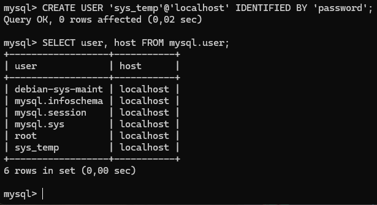
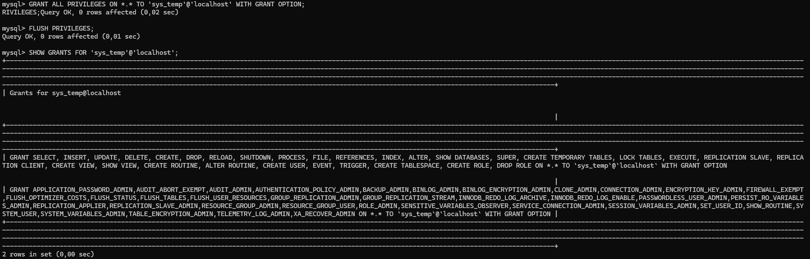
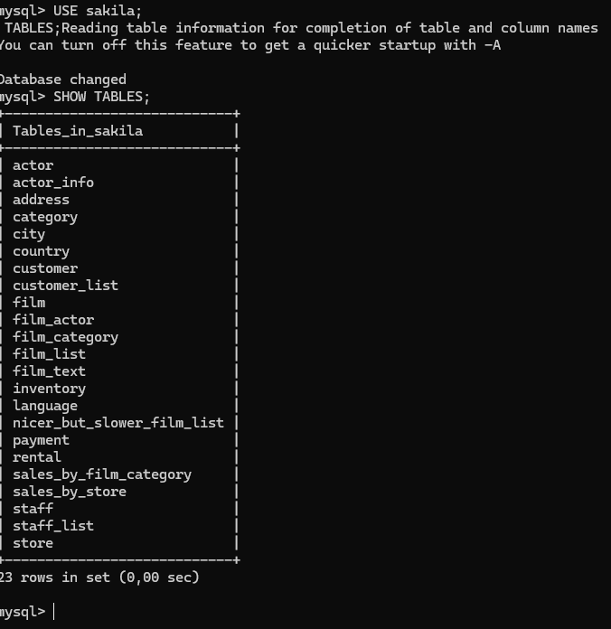
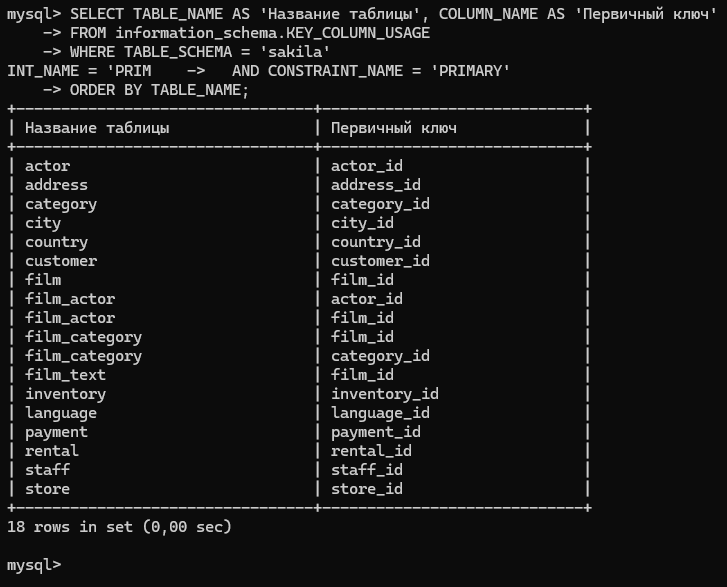

# Домашнее задание по теме "Работа с данными (DDL/DML)"
**Выполнил:** Сидоренко Алексей

## Задание 1

### 1.3. Список пользователей в базе данных

### 1.5. Список прав для пользователя sys_temp

### 1.8. Таблицы базы данных sakila

## Задание 2

### Таблица с названиями таблиц и первичными ключами

Или в текстовом виде:

| Название таблицы | Первичный ключ |
| :--- | :--- |
| actor | actor_id |
| address | address_id |
| category | category_id |
| city | city_id |
| country | country_id |
| customer | customer_id |
| film | film_id |
| film_actor | actor_id, film_id |
| film_category | film_id, category_id |
| film_text | film_id |
| inventory | inventory_id |
| language | language_id |
| payment | payment_id |
| rental | rental_id |
| staff | staff_id |
| store | store_id |
